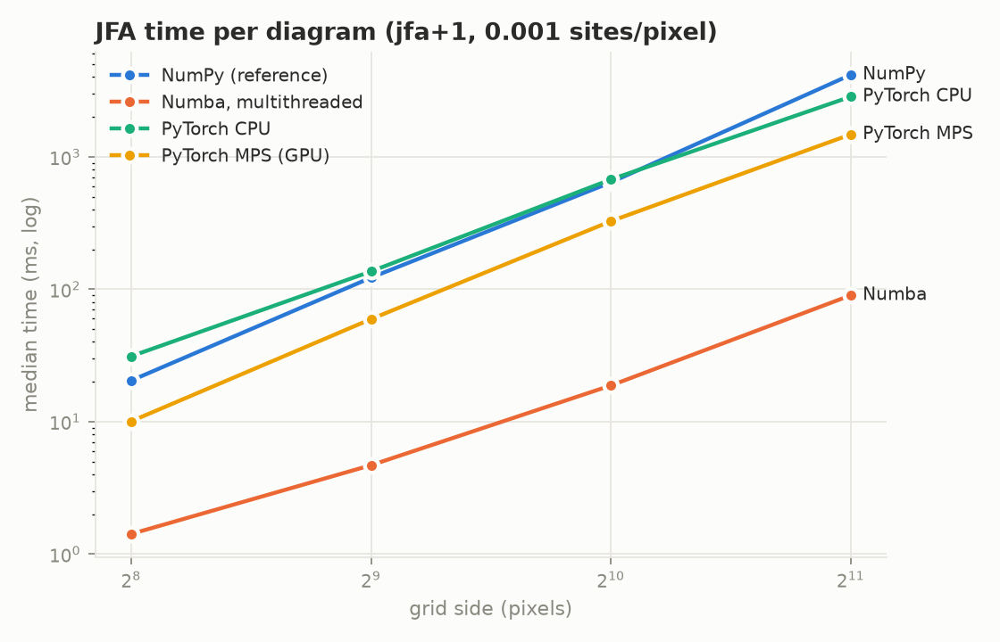
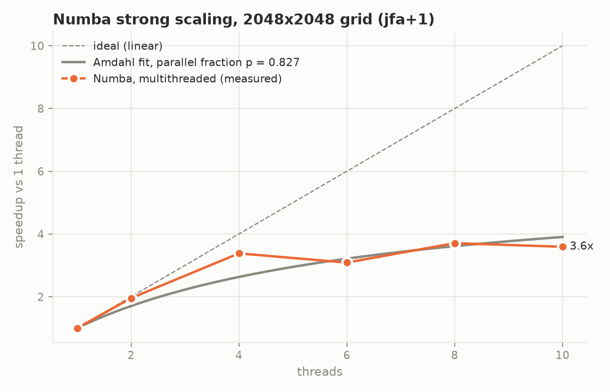
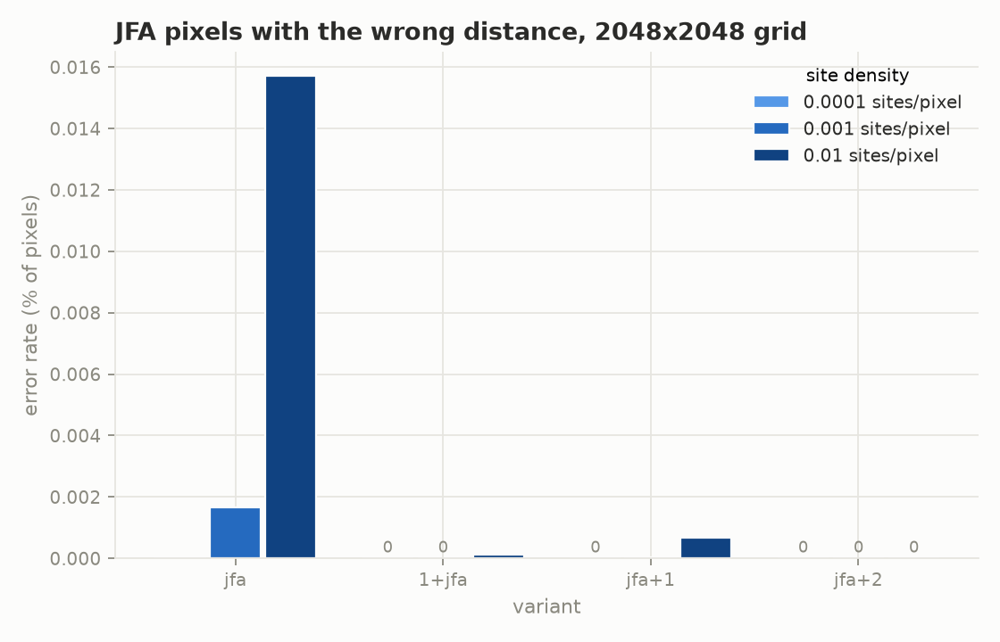
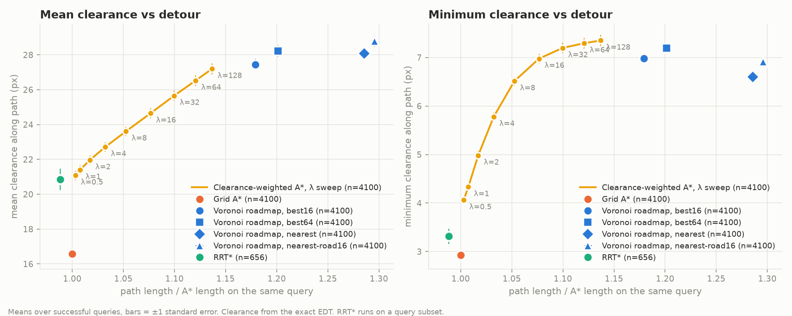
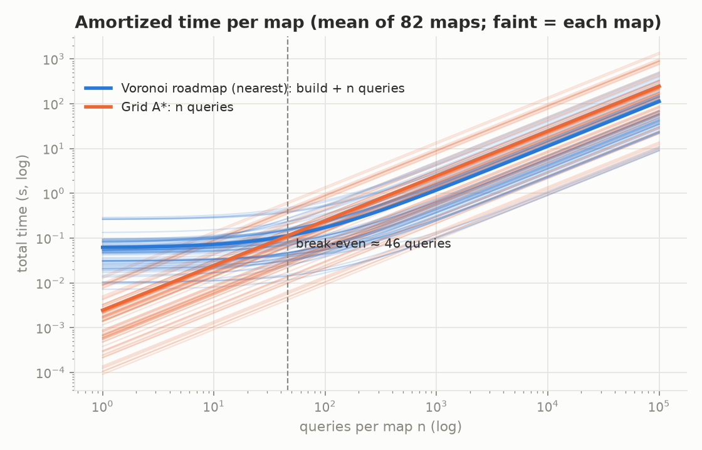
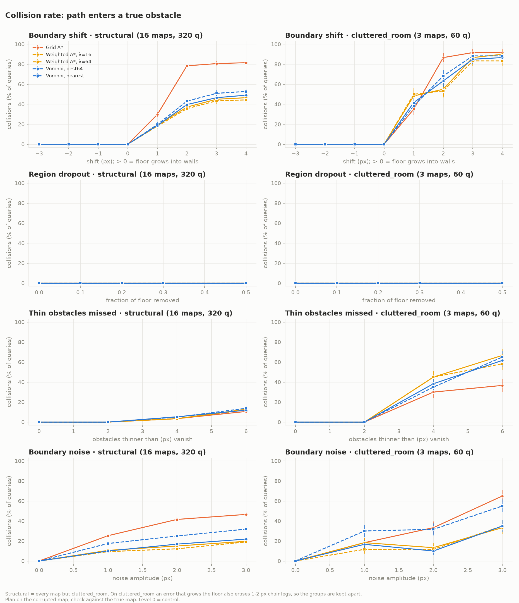
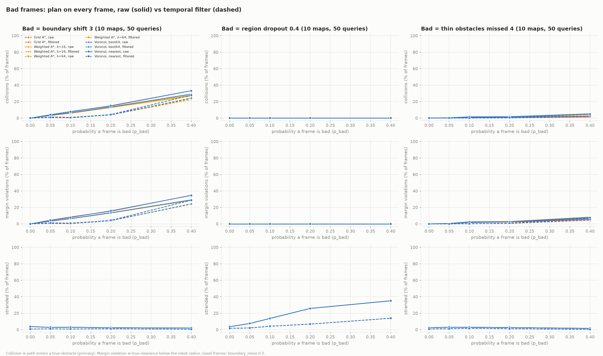
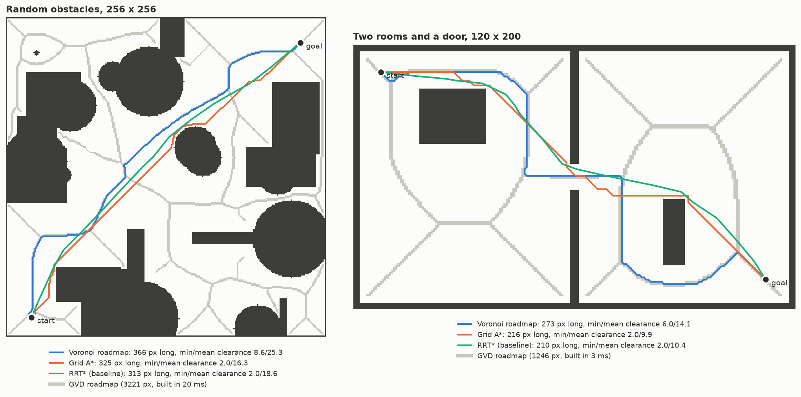

# voronav

From-scratch parallel Voronoi roadmaps for **offline, segmentation-driven
navigation**: SAM free-space masks → generalized Voronoi diagram →
maximum-clearance paths, running entirely autonomously offline.

The core is built without a geometry library: discrete Voronoi diagrams come
from my own Jump Flooding Algorithm (JFA) in three backends — a readable NumPy
reference, a multithreaded Numba CPU kernel and a PyTorch GPU kernel (Apple MPS
or CUDA) — all checked against a brute-force oracle. Every design decision is
visible and tested.


*First-person video (TartanGround) → SAM 2 floor mask → bird's-eye grid →
Voronoi roadmap → path, about 0.5 s per frame on an M4 MacBook Air. Blue: the Voronoi path; orange: the grid A* path.*

## Claim 

The project is designed to support one measurable claim:

> A maximum-clearance roadmap built by a from-scratch parallel Voronoi engine
> on top of SAM segmentation produces safer paths than grid A* at comparable
> or faster planning time, and runs fully autonomously offline.

**Verdict after Q1–Q4:** supported, with caveats. On real SAM 2 masks of
first-person video, the Voronoi planner (`best64`) collided on ≤ 0.1% of
plans against 0.6–1.1% for grid A* (Q4). Against a tuned clearance-weighted
A*, its safety is a tie, and its advantage is query speed on large maps
(Q2). Segmentation, not planning, sets the frame rate: about 1.9 fps
end to end, of which the whole Voronoi side is about 4 ms (Q4). The video is
synthetic, so read Q4 as an upper bound on real-world accuracy.


## Research questions

| # | Question | Status |
| --- | --- | --- |
| Q1 | How does parallel JFA scale across backends, threads and grid size, and how much error does each variant leave? | **results in** (below); GPU and scheduling causes measured and fixed |
| Q2 | Voronoi roadmap vs grid A* vs RRT*: clearance, length, time, success | **answered** (below): safer than A* in 99.5% of queries; ties tuned weighted A* on clearance, wins on query speed |
| Q3 | How does segmentation error carry through to path safety? | **answered** (below): clearance roughly halves collisions from wall errors, does nothing for missed clutter; a temporal vote fixes isolated bad frames |
| Q4 | SAM variants on-device: latency vs mask quality vs path quality | **answered** (below): SAM 2 masks fail safe; clearance planners ≤ 0.1% collisions; ~1.9 fps, segmentation-bound |

## Q1 first results (measured, Apple M4, 10 cores)

`configs/bench_q1.yaml` as committed: 4 grid sizes × 3 site densities × 4
variants × 15 backend configs (NumPy; Numba at 1–10 threads with static and
dynamic row scheduling; PyTorch CPU and MPS) = 720 rows, median of 5 runs
after 2 warmups. Raw data: `docs/runs/q1_results.jsonl`. The first run, from
before the fixes below, is kept in `docs/runs/q1_results_v1.jsonl`.



| `jfa+1`, 2048², 0.001 sites/px | first run | now | vs NumPy (now) |
| --- | --- | --- | --- |
| NumPy reference | 4165 ms | 4144 ms | 1× |
| PyTorch CPU (eager int64) | 2848 ms | 3140 ms | 1.3× |
| Numba, 1 thread | 334 ms | 330 ms | 13× |
| Numba, 10 threads, dynamic rows | (8 threads static: 90 ms) | 72 ms | 58× |
| **PyTorch MPS (fused Metal kernel)** | 1478 ms (eager int64) | **15 ms** | **276×** |

All of these produce the same output, bit for bit (`tests/test_backends_agree.py`).

**The GPU was slow because of unfused ops plus emulated 64-bit division.
Allocation was not the problem.** Both hypotheses from the first run were
measured one at a time (`scripts/probe_mps.py`, output in
`docs/runs/q1_mps_probe.json`, 2048², `jfa+1`):

| implementation | time | what changed |
| --- | --- | --- |
| eager PyTorch, int64 (old backend) | 1441 ms | 141 aten ops per pass, each a full-grid kernel |
| eager PyTorch, int32 | 825 ms | same ops, half the bytes |
| `torch.compile` of the int64 pass | 142 ms | ops fused by Inductor, still int64 math |
| fused Metal kernel, int64 storage + int64 math | 158 ms | one kernel per pass, packed int64 key |
| … int64 storage, a single int64 division per pixel | 45 ms | coordinates split with int32 division |
| … int64 storage, int32 math | 16 ms | no 64-bit arithmetic at all |
| **fused Metal kernel, int32 (new backend)** | **14 ms** | int32 storage and math |

- *Allocation (H2): rejected as stated.* Writing into a preallocated `out=`
  tensor is no faster than allocating (int32 add: 0.85 vs 0.90 ms). PyTorch's
  caching allocator makes allocation cheap. The real cost is what those
  temporaries imply: about 141 separate kernels per pass, each streaming whole
  grids through memory. Every eager op takes about the same time whatever it
  computes (add, floor-divide and remainder are all about 1.4 ms in int64), so
  the eager path is bandwidth-bound. Fusing the work into one kernel gives about 9×.
- *int64 (H1): confirmed, but only for division.* In eager mode int64 costs
  exactly its bytes: 1.7× over int32, with no sign of emulation. Inside a fused
  kernel, where memory traffic no longer dominates, int64 storage costs only
  10% (16 vs 14 ms). But 64-bit integer division and modulo are emulated on
  the Apple GPU: one per pixel triples the pass time, and the ten in the
  packed-key kernel make it 11× slower. `torch.compile` lands at the same
  ~145 ms for the same reason.
- *The fix:* one Metal kernel per pass (`torch.mps.compile_shader`) that
  keeps site indices and distances in int32. It compares `(d2, site)`
  lexicographically instead of building the packed int64 key, which orders
  candidates exactly the same way. Output is converted back to int64, so the
  API is unchanged. Grids over 2³¹ pixels or 46340 px per side fall back to
  the eager int64 path (`jfa_torch.fused_supported`). At 256² and 512² the
  GPU sits at a ~1.2 ms floor of launch and sync overhead, which is still
  slightly faster than Numba at 256² (1.3 ms).



**The 6-thread dip was load imbalance from static row splitting. Dynamic
scheduling removes it.** With `prange`'s static split, speedup at 2048² rises
to 3.3× at 4 threads, falls to 3.1× at 6, and ends at 3.6× at 10. The M4 has 4
performance and 6 efficiency cores, and each thread gets the same number of
rows, so the efficiency-core threads finish last. The fix that looks obvious
does nothing: `numba.set_parallel_chunksize` still gave every thread exactly
H / threads rows on both the workqueue and OpenMP layers, and timings did not
change. (A compute-only kernel with no memory traffic shows no dip, so the
efficiency cores fall further behind on JFA's memory-heavy passes.) The Numba
backend now claims rows 4 at a time from a shared atomic counter (an LLVM
`atomicrmw` through `numba.extending.intrinsic`), so faster cores take more
rows. Speedup is now monotonic: 3.4× at 4, 3.8× at 6, 4.1× at 8, 4.6× at 10
(72 ms). Chunks of 1, 4 and 16 rows measured within noise. The Amdahl fit
(p = 0.875) describes the dynamic curve reasonably; what remains is the
efficiency cores being slower, not a serial fraction.



**Error:** plain JFA gets the distance wrong at 1.6e-4 of pixels at the highest
density, with the worst pixel off by 3.4 px. One extra k=1 pass helps more when
it runs *first*: `1+jfa` leaves 1.2e-6 versus 6.7e-6 for `jfa+1` at the same
cost. `jfa+2` was exact on every instance measured here (one seed per
configuration). The roadmap default should be `1+jfa` or `jfa+2`, with the
choice made in Q2 by whether the residual error changes paths.

Caveats: one seed, one machine, and laptop timings are sensitive to thermal
throttling and background load.

## Q2 results: Voronoi roadmap vs A*, weighted A* and RRT*

`configs/bench_q2.yaml` as committed: **94 maps** (20 random-obstacle maps at
128²–1024², a corridor, 3 two-room maps, 50 MovingAI maps in 5 sets, 20
HouseExpo houses), up to 50 seeded start/goal pairs per map, robot radius 2 px.
Every planner ran the same **4,100 queries**: 58,220 planner runs in 17
minutes on the M4 MacBook Air. Roadmap bridges are clearance-weighted
(`bridge_lam: 64`); see "Study history" below for the earlier run. All successful paths from every planner passed
the independent collision check (exact EDT), with **zero failures**. Grid A*,
weighted A* and every Voronoi variant solved 4,100 of 4,100; RRT* (3,000
iterations, every 5th query) solved 656 of 820. Raw data:
`docs/runs/q2_results.jsonl.gz` (`gunzip -k` to use); all tables: [`docs/q2/q2_summary.md`](docs/q2/q2_summary.md).



| planner (raw paths) | length / A* (median) | mean clearance | min clearance | median query |
| --- | --- | --- | --- | --- |
| Grid A* | 1.00 | 16.6 px | 2.93 px | 1.12 ms |
| Weighted A*, λ = 16 | 1.07 | 24.6 px | 6.98 px | 4.36 ms |
| Weighted A*, λ = 64 | 1.11 | 26.5 px | 7.29 px | 5.28 ms |
| **Voronoi, `nearest`** (original) | 1.25 | 28.3 px | 6.80 px | **0.78 ms** |
| Voronoi, `nearest-road16` | 1.26 | 29.0 px | 7.12 px | 1.02 ms |
| **Voronoi, `best64`** (joint join, weighted roadmap) | 1.18 | 28.4 px | 7.24 px | 3.96 ms |
| RRT* (pure Python, 656 solved) | 0.96 | 20.8 px | 3.31 px | 184 ms |

**Against grid A\*, the claim holds.** On the same queries, the original
Voronoi planner's minimum clearance was at least A*'s in **99.5%** of queries,
mean clearance was 11.7 px higher (+70%), and paths were 25% longer. Queries
were 1.5× faster once the roadmap was built. The build pays for itself after
about 46 queries per map:



**Against a tuned clearance-weighted A\*, clearance is a tie, and speed is
the difference.** Weighted A* traces a smooth curve of length against
clearance, and the Voronoi variants sit at its high-clearance end. Paired by
query, `best64` against λ = 64:

- minimum clearance equal or higher in **96.5%** of queries (median difference
  exactly 0), mean clearance +1.8 px, paths 5.8% longer, queries 1.5× faster;
- the speedup grows with map size (2.4–2.7× on random 512²–1024²) and
  *reverses* on small maps (0.7× on HouseExpo houses, which average 311 px),
  where the three-layer joint join costs more than it saves;
- `nearest-road16` against λ = 16 trades the other way: 3.6× faster and
  +4.4 px mean clearance, but 16.4% longer.

So the honest headline is: **Voronoi roadmaps match the safety of a tuned
weighted A\*, and are faster per query on large maps once built.** It is not
that they are uniquely safe.

**Where Voronoi loses:**

1. **Rare but large minimum-clearance losses.** In 43 of 4,100 queries
   (72 with shortest-path bridges), `best64`'s narrowest point was more than
   2 px tighter than weighted A*'s (worst 16 px), concentrated on street maps.
   That's why its *average* minimum (7.24 px) still trails λ = 64 (7.29 px)
   despite the 96.5% tie-or-win rate. The causes were diagnosed on the
   original 72 (docs/Q2_HARNESS.md): the open map edge (29), shortest-path
   bridges (23, now fixed), the λ cost setting (17) and skeleton gaps (3).
   The map edge remains: the roadmap treats the edge of an unwalled map as
   open space, so it doesn't steer away from it.
2. **Narrow-passage maps** (supplement, below): 1.8–2.4× longer paths on room
   maps for about 1 px more clearance.
3. **Fragmented skeletons need many bridges:** Baldur's Gate maps average 62
   per map and room maps 865. Since the repair became a single pass, builds
   stay at a median of 10–260 ms per map family (the 1024² maps are slowest).

**Smoothing** (applied identically to every planner, never lowering the
minimum clearance) closes most of the length gap. Smoothed `best64` is 1.13×
A* length against 1.10× for smoothed λ = 64 weighted A*, with clearances
unchanged.

### Supplement: narrow-passage maps (robot radius 1 px)

At radius 2 px, all 10 MovingAI *room* maps and 2 of the *maze* maps
produced **no queries**: their 1–2 px doors and corridors are closed to a
radius-2 robot, so no start/goal pair lies in one reachable region. The
harness logged this, but the first summary silently dropped those maps, so
they are reported here as a separate condition (`configs/bench_q2_narrow.yaml`;
20 maps, 1,000 queries, 14,200 runs, zero collisions; raw data
`docs/runs/q2_narrow_results.jsonl.gz`;
[`docs/q2/q2_narrow_summary.md`](docs/q2/q2_narrow_summary.md)):

| set | Voronoi `nearest` vs A*: length | mean clearance gain | `best64` vs λ = 64 weighted A*: length | speedup |
| --- | --- | --- | --- | --- |
| maze (10) | 1.24× | +3.6 px | 1.02× | 1.9× |
| room (10) | **2.10×** | +3.2 px | **1.92×** | 4.2× |

Room maps are Voronoi's worst case. Every 1 px door limits all planners to
the same minimum clearance, so the skeleton's detours through room centers
buy almost nothing. Clearance-weighted bridges make this slightly worse than
shortest ones (2.02× in the first run). The skeleton is extremely fragmented
(the 8-room maps need about 2,950 bridges), which originally took 25 s to
repair with one search per bridge; the single-pass repair builds every room
map in 79–117 ms. RRT* solved 1 of 200 queries in these maps, the known
failure of sampling planners in narrow passages.

### Study history

The study was run twice, and both versions are in git history.

- **v1** (commit `c06bd4e`): shortest-path bridges. 72 large clearance
  losses to weighted A*, a 95.0% tie-or-win rate, and up to 25 s builds on
  room maps.
- **v2** (this section): after diagnosing those losses, bridges are
  clearance-weighted and the repair runs as a single pass. Large losses fell
  to 43, the tie-or-win rate rose to 96.5%, the original planner's minimum
  clearance rose from 6.60 to 6.80 px, and builds got 2–300× faster. Same
  maps, queries and seeds; only the roadmap changed.

### Caught by a fail-loud check

The first full run crashed on MovingAI `dao/lak303d` with "skeleton piece
unreachable inside its own region", an assertion in the roadmap repair. Free
regions had been labeled with 8-connectivity, but searches may not cut
corners, so two areas touching only at a corner are not mutually reachable:
that map has 4 regions under 8-connectivity but 24 reachable ones. Regions
and skeleton pieces are now labeled by `reachable_components`, using the
search's exact move rule, and a regression test covers the diagonal pinch.
The query sampler had the same mismatch and was fixed too. The run was
restarted from scratch, so no reported number mixes old and new code.

## Q3 results: what segmentation errors do to path safety

A robot plans on its segmentation mask but collides with the real world. So
each true map is corrupted the way a segmentation model gets it wrong, every
planner plans on the corrupted map, and the path is graded on the **true**
map (exact EDT). Four error models (`src/voronav/corruption.py`,
[`docs/Q3_ERRORS.md`](docs/Q3_ERRORS.md)), chosen from real SAM failure modes:

| model | SAM failure | level |
| --- | --- | --- |
| `boundary_shift` | floor mask bleeds into walls (> 0) or shrinks away from them (< 0) | px |
| `region_dropout` | clipping, or "part instead of whole": chunks of floor missing | fraction of floor |
| `thin_obstacle_miss` | fine detail merged into the floor: chair legs, poles, railings vanish | width threshold, px |
| `boundary_noise` | ragged, spatially correlated edge error | amplitude, px |

`configs/bench_q3.yaml`: 19 maps (random obstacles, two rooms, 6 HouseExpo
houses, 6 MovingAI maps, and 3 `cluttered_room` maps full of 1–4 px legs and
poles), 20 queries each, robot radius 2 px, 39,900 planner runs. Part B
(below) adds 150,000 per-frame plans. 11 minutes on the M4 MacBook Air. Raw
data: `docs/runs/q3_results.jsonl.gz`; all tables:
[`docs/q3/q3_summary.md`](docs/q3/q3_summary.md). Every level-0 control
had 0 collisions and 0 strandings.



Collision % (the path enters a true obstacle). Structural = every map except
`cluttered_room`:

| error | A* | weighted A* λ=64 | Voronoi `nearest` | Voronoi `best64` |
| --- | --- | --- | --- | --- |
| structural, floor leaks 1 px | 30 | 18 | 20 | 19 |
| structural, floor leaks 2 px (= robot radius) | **78** | **36** | 43 | **40** |
| structural, noise 2 px | 42 | 12 | 25 | 17 |
| cluttered, legs ≤ 4 px missed | **30** | 45 | 35 | 38 |
| cluttered, legs ≤ 6 px missed | **37** | 58 | 65 | 62 |
| any map, floor shrinks or chunks drop out | 0 | 0 | 0 | 0 |

**1. Errors that shrink the floor fail safe.** Shrinking the floor and dropping
out regions (the user's "clipping" and "part instead of whole") caused zero
collisions at every level on every map. They strand the robot instead: up to
38% of queries at −3 px and 96–98% at 50% dropout, mostly because an endpoint
no longer looks safe.

**2. Against wall errors, clearance pays: it roughly halves collisions.** When
the floor leaks 2 px into the walls, plain A* collides on 78% of structural
queries, against 36–40% for weighted A* and Voronoi `best64`. Boundary noise
shows the same order. The original Voronoi `nearest` is in between, because
its legs onto and off the roadmap are shortest paths that hug walls. That's
the Q2 refinement paying off under error.

**3. Against missed clutter, clearance does not help. It slightly hurts.** On
`cluttered_room`, when legs and poles vanish from the mask, A* collides
*least* (30–37%), and the clearance-seeking planners collide most (45–65%).
They route through the middle of rooms, which is exactly where the erased
furniture stands. Clearance from the walls says nothing about an obstacle
the map no longer contains.

**4. On real maps, a 1 px leak breaches thin walls.** Synthetic maps with
thick walls had 0 collisions at +1 px. HouseExpo and MovingAI had 25–32%,
for every planner. A 2 px wall that loses 1 px from each side disappears, so
it opens a gap that looks like a doorway (up to 11 per house; 77 on MovingAI
`brc505d`, which also loses 93 small obstacles entirely). Planners route
through the fake doorways. This is also why even small leaks matter on real
floor plans.

### Part B: a few bad frames vs a bad stream

The user's requirement for video: a few bad frames are acceptable, a bad
stream is not. Each sequence has 20 frames with mild noise. Each frame is
independently a "bad" frame (one severe error) with probability *p*, and
the planner plans on every frame, either raw or after
`temporal.temporal_filter`: an IoU outlier gate, then a majority vote over
the last 5 accepted masks.



| bad frames are… | p = 0.1 | p = 0.2 | p = 0.4 |
| --- | --- | --- | --- |
| floor leaks 3 px: collisions, raw → filtered | 7% → 1% | **14% → 4%** | 30% → 25% |
| 40% dropout: stranded, raw → filtered | 14% → 4% | **26% → 7%** | 35% → 14% |
| legs ≤ 4 px missed: collisions, raw → filtered | 1% → 0% | 1% → 0% | 3% → 3% |

**The vote works while bad frames are a minority.** It cuts collisions about
3.5× and strandings about 3.7× at p = 0.2, and it stops helping at p = 0.4,
when bad frames often hold the majority of the window. That matches the
requirement: isolated bad frames are absorbed, while a sustained failure
shows through.

**The outlier gate is blind to the dangerous errors:**

| bad frames are… | gate recall | gate precision |
| --- | --- | --- |
| 40% floor dropout | **91%** | 89% |
| floor leaks 3 px | **0%** | – |
| legs ≤ 4 px missed | **0%** | – |

The gate compares each mask's free-space IoU with the last accepted mask. A
3 px leak changes IoU too little to trip it (a median of about 0.88 in the quick run, against a 0.8
threshold), and erasing legs changes it almost not at all (bad frames even
score slightly *higher* than good ones). So the gate catches only the
fail-safe error, and every bit of protection against the dangerous errors
comes from the vote. The missed-clutter rows are too rare to judge: only
1–3% of frames collided even before filtering.

### What Q3 means for the vision pipeline (Q4)

- **Prefer masks that err on the side of shrinking.** Shrinking fails safe,
  and leaking does not. Erode the floor mask a little, or prompt
  conservatively.
- **Clearance planning is the right defense against wall errors.** It needs
  `best64` or weighted A*, not the original `nearest` planner.
- **Thin obstacles need a separate safeguard:** a separate obstacle prompt, a
  lower bound on obstacle size, or a second sensor. Neither clearance nor the
  IoU gate can see them.
- **Keep the temporal vote,** and replace the IoU gate with a check that is
  sensitive to *added* floor (for example, the count of newly free pixels
  near the previous boundary). That improvement is measurable in Q4.

## Q4 results: real SAM 2 on first-person video

**Question:** is SAM 2 on first-person video accurate enough to plan on,
and how fast does it run offline on a fanless M4 MacBook Air?

**Setup:** 3 indoor sequences from TartanGround (a hospital, an abandoned
school, an office; 150 frames each; robot camera at 0.6–1.4 m; CC BY 4.0),
which come with ground-truth floor labels and exact camera poses. SAM 2 is
prompted once on the first frame (positive points low on the floor, negative
points in the upper corners) and tracks the floor with its video memory.
Each mask goes through a flat-ground homography to a bird's-eye grid (5 cm
cells, 5 m ahead × 8 m wide; unseen = obstacle). Planners plan on SAM's grid
and are graded on the ground-truth grid, exactly as in Q3. Conditions: SAM
2 tiny vs small × 2 mask-selection rules × erosion 0 or 2 px × raw frames vs
an ego-motion-aligned temporal vote. Result: 165,792 graded plans in
23 minutes. Details and caveats: [`docs/Q4_HARNESS.md`](docs/Q4_HARNESS.md);
tables: [`docs/q4/q4_summary.md`](docs/q4/q4_summary.md); data and SAM setup:
[`docs/Q4_DATA.md`](docs/Q4_DATA.md), [`docs/Q4_SAM.md`](docs/Q4_SAM.md).

| | SAM 2 tiny | SAM 2 small |
| --- | --- | --- |
| image IoU vs ground truth (mean) | 0.964 | 0.969 |
| falsely free floor (the dangerous error), image | 0.01% | 0.04% |
| floor missed (fails safe), image | 3.6% | 3.0% |
| bird's-eye IoU | 0.916 | 0.933 |
| end-to-end latency, median / p90 | **527 / 608 ms** | 637 / 718 ms |

**1. SAM 2 errs on the safe side.** It misses about 100× more floor than it
invents. By Q3's results, that means it strands more than it crashes.

**2. The planner still matters.** Collision % of plans, raw frames,
erosion 0:

| | A* | weighted A* λ64 | Voronoi `nearest` | Voronoi `best64` | stranded |
| --- | --- | --- | --- | --- | --- |
| ground-truth grid (control) | 0.0 | 0.0 | 0.0 | 0.0 | 0.0 |
| SAM 2 tiny | 0.8 | 0.0 | 0.0 | **0.0** | 12.7 |
| SAM 2 small | 0.7 | 0.1 | 0.2 | **0.1** | 15.8 |

Every raw SAM collision traces to one object: a flat sign lying on the
school corridor's floor, which SAM calls floor for 15 consecutive frames.
That's Q3's thin-obstacle miss, met in the wild. Grid A* cuts across it,
and the clearance-aware planners keep their distance and pass. (Whether a
flat sign is an obstacle at all is arguably a labeling question.)

**3. SAM's leaks are much milder than Q3's worst case.** Q3's uniform 3 px
leak caused 45–90% collisions. SAM's leaks touch only 1–2% of the boundary
and stay local. A single camera view is also nearly "star-shaped" around the
robot, so short paths to visible goals rarely graze a boundary.
`q4_on_q3.png` places SAM's frames on Q3's curves.

**4. What did not pay off on real masks:**
- *Erosion* (Q3's "err toward shrinking"). SAM already errs that way.
  Eroding 2 px removes almost no false floor but raises stranding by 7–10
  points. The recommended setting is erosion 0.
- *Mask-selection rule.* For tiny, SAM's top-scoring mask already was the
  largest consistent one on all 3 sequences. The "part instead of whole"
  failure didn't occur with these prompts.
- *Temporal vote.* It can't fix a sustained error (the sign held the
  majority), and its warp across frames costs about 4–6 points of stranding.
  SAM 2's own video memory already provides most of the temporal consistency.

**5. The leak gate Q3 asked for works on leaks, not clutter.** On injected
3 px leaks under real camera motion, the new "added floor near the boundary"
gate catches 65% at 88% precision, where Q3's IoU gate catches 8%. Neither
gate sees a vanished thin obstacle.

**6. Segmentation sets the speed.** SAM 2 is more than 99% of the frame
time. The bird's-eye warp, JFA roadmap and Voronoi plan together take about
4 ms. A tracking dropout happened once: tiny lost the hospital floor for 2
frames after a sharp turn, which stranded the robot safely, and recovered.

**Caveats:** synthetic Unreal-rendered video (clean textures, no blur, so
this is an upper bound on real-world accuracy); 3 sequences of 15 s, so one
object can dominate a rate; ground-truth poses instead of odometry for the
vote; flat-floor assumption; goals limited to visible floor 2–4.5 m away.
The natural follow-up is real RGB-D video (ScanNet, which requires its
terms of use to be signed) or the user's own recordings.

## Week 3: roadmap and planners



- **Roadmap:** obstacle boundary pixels → JFA (`jfa+2`, exact in every Q1
  instance) → generalized Voronoi diagram (GVD) pixels → one connected skeleton
  per free region. It takes 3–20 ms at 256² on the M4.
- **Planners:** the Voronoi planner joins the skeleton at the nearest skeleton
  pixel, follows it with A*, and leaves it at the goal. Grid A* and
  multi-source Dijkstra are compiled with Numba and share one search routine.
  RRT* is a pure-Python baseline, so only its path quality is comparable, not
  its timing.
- **Metrics** use SciPy's exact distance transform, independent of the
  JFA field the roadmap was built on, so the planner doesn't grade its own work.
- **First look:** on 15 random queries over 4 maps (robot radius 2 px),
  Voronoi paths averaged 21.6 px mean clearance against 13.9 for A*, and were
  about 24% longer. The full comparison is in Q2 results, above.

Three design problems were caught while building this, and all are kept as tests:

1. **The angle rule broke real roadmap edges.** The first test for a GVD edge
   was angle-only: the two nearest sites must subtend at least 60°. It removed
   real boundaries where two different obstacles lie in similar directions
   from a pixel, splitting one free region's roadmap into about 120 pieces.
   Now sites on *different* obstacles always form an edge, and the angle rule
   (with a 2 px tolerance for pixel staircases on curves) applies only within
   one obstacle. Obstacles are labeled with the outer 1 px frame removed, so a
   border wall doesn't merge everything that touches it.
2. **Pruning to the largest piece deleted a door.** Keeping only the largest
   skeleton piece per region cut the line through a door between two rooms.
   Pieces are now joined by the shortest safe path between them, and only
   fragments under 8 px are dropped. `n_bridges`, `bridge_px` and `n_pruned`
   are recorded for every map.
3. **RRT\* collision check too coarse.** RRT* checked segments every 0.5 px
   while the independent metric checked every 0.25 px, and the metric caught
   corner pixels the planner had skipped. Both now use 0.25 px.

**Known limitation:** joining the skeleton at the *nearest* pixel can make a
short detour into a corner spur (visible at the start of the two-rooms path).
Shortcutting the entry and exit segments is a week-4 candidate, to be
measured, not assumed.

## Design notes

- **One representation.** A Voronoi diagram is `nearest[H, W]` (int64): the
  flat index of each pixel's nearest site, or -1 if there are no sites.
- **Bit-identical backends.** Every backend compares the packed integer key
  `d2 * H*W + site`, so ties break the same way regardless of visit order or
  thread scheduling. (The int32 Metal kernel compares `(d2, site)`
  lexicographically instead, which gives the same order without 64-bit
  math.) Backends are checked against each other with
  `array_equal`, not a tolerance, which means a speedup in Q1 never comes with
  an accuracy caveat.
- **Error is measured on distance, not labels.** JFA can only choose among the
  sites it propagated to a pixel, so on exact ties it can pick a different, equally
  near site than the oracle. That is still a correct Voronoi assignment. (The
  first version of the property tests asserted label equality and caught this.)
- **One-sided error.** JFA can assign a site that is too far, never one that
  is too near. The tests check that bound directly against the oracle.
- **Two independent exact references.** The brute-force oracle (same tie-break
  rule) is itself checked against SciPy's Euclidean distance transform.
- **Generalized Voronoi diagram sites.** For an occupancy grid, the sites are obstacle
  pixels 4-adjacent to free space. Interior obstacle pixels never win a
  nearest-site query from free space.
- **OpenMP clash.** On macOS, Numba's default OpenMP threading layer and the
  libomp bundled with PyTorch abort the process when both load
  (`OMP: Error #15`). Numba is pinned to its `workqueue` layer; override it
  with `NUMBA_THREADING_LAYER`.
- **Fail loudly.** Unknown config keys, backends and variants raise errors before a
  sweep starts.

## Layout

```
src/voronav/
  config.py            dataclass configs, strict YAML loading
  maps.py              synthetic maps, MovingAI .map + image-mask loaders, boundary sites
  voronoi/
    common.py          representation, tie-break, step schedules, distance
    oracle.py          brute-force exact diagram
    jfa_numpy.py       reference JFA
    jfa_numba.py       multithreaded CPU JFA (dynamic or static row scheduling)
    jfa_torch.py       fused int32 Metal kernel on MPS; eager int64 on CPU / CUDA
  planning/
    roadmap.py         GVD extraction, frame-aware obstacle labels, piece bridging
    grid_search.py     Numba A* / multi-source Dijkstra, 8-connected, no corner cutting
    planners.py        Voronoi roadmap (join / roadmap-weight variants), grid A*,
                       clearance-weighted A*, RRT* (baseline)
    smoothing.py       line-of-sight shortcutting, applied equally to every planner
    metrics.py         length / clearance / smoothness against the exact EDT
  map_sources.py       map registry: synthetic generators (incl. cluttered_room) + MovingAI / image / HouseExpo dirs
  corruption.py        Q3 segmentation-error models + mask error stats
  temporal.py          Q3 bad-frame sequences + causal temporal filter
  vision/              Q4: dataset loader, bird's-eye homography, SAM 2 floor
                       segmentation, ego-motion alignment
  demo.py, cli.py      the `voronav demo` command (offline GIF)
configs/               debug.yaml (seconds), bench_quick.yaml (~10 s),
                       bench_q1.yaml (full Q1 sweep, heavy), bench_q2_quick.yaml,
                       bench_q2.yaml (full Q2 study), bench_q2_narrow.yaml,
                       bench_q3_quick.yaml, bench_q3.yaml (full Q3 study),
                       bench_q4.yaml (Q4 study), debug_*.yaml (test fixtures)
scripts/               bench_jfa.py (harness -> JSONL), plot_q1.py (figures),
                       probe_mps.py (why eager MPS was slow), plan_demo.py (Q2 figure),
                       fetch_maps.py (benchmark maps, see docs/DATA.md),
                       bench_plan.py / plot_q2.py / summarize_q2.py (Q2 study),
                       bench_q3.py / plot_q3.py / summarize_q3.py (Q3 study),
                       fetch_q4_data.py / fetch_sam2.py / time_sam2.py (Q4 setup),
                       bench_q4.py / plot_q4.py / summarize_q4.py (Q4 study),
                       demo.py (wrapper for `voronav demo`)
tests/                 property, cross-backend, loader, config, end-to-end
```

## Quickstart

```bash
python3 -m venv .venv && .venv/bin/pip install -e ".[dev,torch]"
.venv/bin/python -m pytest -q                                          # ~16 s
.venv/bin/python scripts/bench_jfa.py --config configs/bench_quick.yaml # ~10 s, light
.venv/bin/python scripts/plan_demo.py --out docs/q2                     # ~2 s
```

**Optional C++ core.** `core/` holds a C++20 port in progress, packaged
separately so the install above never needs a compiler. With CMake and Ninja
installed, `.venv/bin/pip install -e ./core` adds it; see
[`core/README.md`](core/README.md).

The full Q1 study (`configs/bench_q1.yaml`) is about 5,000 diagrams and over
30 minutes of all-core load. On a fanless laptop, run it once, plugged in; it
pauses 2 s between rows to limit thermal-throttling bias:

```bash
.venv/bin/python scripts/bench_jfa.py --config configs/bench_q1.yaml
.venv/bin/python scripts/plot_q1.py runs/bench_q1/results.jsonl --out docs/q1
```

The Q2 study needs the benchmark maps (`scripts/fetch_maps.py`, about 64 MB;
see `docs/DATA.md`). The main sweep takes about 17 minutes and the
narrow-passage supplement about 7, mostly single-core:

```bash
.venv/bin/python scripts/bench_plan.py --config configs/bench_q2.yaml
.venv/bin/python scripts/plot_q2.py runs/bench_q2/results.jsonl --out docs/q2
.venv/bin/python scripts/summarize_q2.py runs/bench_q2/results.jsonl > docs/q2/q2_summary.md
```

The Q3 study takes about 11 minutes:

```bash
.venv/bin/python scripts/bench_q3.py --config configs/bench_q3.yaml
.venv/bin/python scripts/plot_q3.py runs/bench_q3/results.jsonl --out docs/q3
.venv/bin/python scripts/summarize_q3.py runs/bench_q3/results.jsonl > docs/q3/q3_summary.md
```

Q4 needs the vision extra (SAM 2, built without CUDA; see
[`docs/Q4_SAM.md`](docs/Q4_SAM.md)), its weights (about 340 MB) and the
TartanGround subset (about 250 MB). The study takes about 23 minutes; the
demo needs no ground truth:

```bash
.venv/bin/python scripts/fetch_q4_data.py && .venv/bin/python scripts/fetch_sam2.py
.venv/bin/python scripts/bench_q4.py --config configs/bench_q4.yaml
.venv/bin/python -m voronav demo data/raw/q4/AbandonedSchool_P1001 --out docs/q4/demo.gif
```

## Testing

358 tests run in about 16 s (1 skipped without SAM 2 weights) on a laptop with no downloads. Every property test
runs on every available backend (NumPy, Numba, PyTorch CPU, and MPS or CUDA
when present).

- **Oracle:** matches SciPy's EDT exactly; the tie-break is hand-checked;
  chunking has no effect on the result.
- **JFA properties:** a single site gives an exact result; every pixel is
  assigned to a real site; each site maps to itself; error is one-sided;
  degenerate shapes (1×1, 1×N, N×1) are handled; the error rate is pinned on
  fixed seeds, and the extra pass in `jfa+1` never increases it.
- **Cross-backend:** Numba, Torch CPU and Torch MPS match the NumPy reference
  bit for bit on sparse, dense and obstacle maps for every variant. Numba
  gives the same output at any thread count, schedule and chunk size. Both
  MPS paths (the fused Metal kernel and eager int64) are tested separately,
  including on a site lattice full of exact ties.
- **Grid search:** A* path costs match SciPy's csgraph Dijkstra on the same
  graph (an independent oracle). Also covered: no corner cutting, the
  nearest-target Dijkstra, and unreachable goals.
- **Roadmap:** the corridor skeleton is exactly the centerline; the roadmap
  passes through a door between two rooms; there is one connected piece per free
  region; the robot radius is respected; obstacles touching the border are labeled
  separately; bridging and fragment-dropping are checked by hand.
- **Planners:** a corridor end-to-end test with a known answer. A* runs
  straight along the wall (109 px, clearance 2), while Voronoi follows the
  centerline (clearance ≥ 7) and is longer. Every planner's path is
  collision-free under the independent check; A* is never beaten on grid
  length; RRT* is reproducible from its seed.
- **End to end:** the benchmark harness and the plotting script run on the debug config
  and produce well-formed rows and figures.

## References

- Rong & Tan, "Jump Flooding in GPU with Applications to Voronoi Diagram and
  Distance Transform", I3D 2006 (JFA, and the JFA+1 / 1+JFA variants)
- Aurenhammer, "Voronoi Diagrams — A Survey of a Fundamental Geometric Data
  Structure", ACM Computing Surveys 1991
- Choset & Burdick, "Sensor-Based Exploration: The Hierarchical Generalized
  Voronoi Graph", IJRR 2000 (generalized Voronoi diagram roadmaps)
- Sturtevant, "Benchmarks for Grid-Based Pathfinding", IEEE TCIAIG 2012
  (MovingAI maps)
- Karaman & Frazzoli, "Sampling-based Algorithms for Optimal Motion
  Planning", IJRR 2011 (RRT*)
- Attali & Montanvert, "Computing and Simplifying 2D and 3D Continuous
  Skeletons", CVIU 1997; Shaked & Bruckstein, "Pruning Medial Axes", CVIU 1998
  (object-angle pruning)
- Kirillov et al., "Segment Anything", ICCV 2023; Ravi et al., "SAM 2", 2024
- TartanGround (CMU AirLab, ETH), IROS 2025, CC BY 4.0 (Q4 video and labels);
  built on TartanAir, Wang et al., IROS 2020

## License

The code in this repository is MIT-licensed; see [`LICENSE`](LICENSE).

Third-party material keeps its own terms:
- **Datasets are not redistributed.** The fetch scripts download them from
  their sources: MovingAI, HouseExpo and TartanGround (licenses and
  attribution in [`docs/DATA.md`](docs/DATA.md) and
  [`docs/Q4_DATA.md`](docs/Q4_DATA.md)).
- **`docs/q4/demo.gif`** contains frames from TartanGround © Carnegie Mellon
  University AirLab, used under CC BY 4.0.
- **SAM 2** (code and checkpoints) is Apache-2.0 and is installed separately,
  not vendored ([`docs/Q4_SAM.md`](docs/Q4_SAM.md)).
