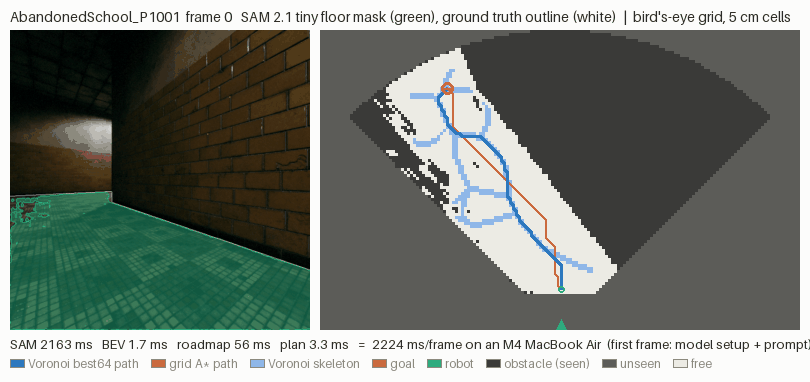

# Q4 harness: real SAM 2 on real first-person video

Q4 asks: **is real SAM 2 on first-person video accurate enough to plan
safely on, and how fast does it run offline on an M4 MacBook Air?**

Q3 answered the first half for synthetic errors: floor that leaks into
obstacles is the dangerous error, floor that shrinks only strands the
planner. Q4 replaces the synthetic errors with SAM 2's real ones. The
method is the same: **segment, project to a bird's-eye grid, plan on that
grid, grade the path on the ground-truth grid of the same frame.** Data
(TartanGround, `docs/Q4_DATA.md`) and the SAM 2 wrapper (`docs/Q4_SAM.md`)
are documented separately; this page covers the harness, the results and
the caveats.

```bash
python scripts/bench_q4.py --config configs/bench_q4.yaml      # the study (~25 min, plugged in)
python scripts/plot_q4.py runs/bench_q4/results.jsonl --out docs/q4
python scripts/summarize_q4.py runs/bench_q4/results.jsonl > docs/q4/q4_summary.md
python scripts/demo.py data/raw/q4/Hospital_P1000 --gt-outline --out docs/q4/demo.gif
```

`voronav demo …` is the same as `scripts/demo.py` once the package is
reinstalled (`pip install -e .` registers the console script; `python -m
voronav demo …` works without reinstalling).

## Results (full run, 2026-10-16)

3 TartanGround sequences × 150 frames, 8 SAM conditions, 3 streams, 4
planners, 3 goals per frame: 165,792 graded plans in 22.6 min on the M4 (SAM
≈ 12 min of it). Tables: `docs/q4/q4_summary.md`; raw rows:
`docs/runs/q4_results.jsonl.gz` (5.4 MB).



**Short answer: yes, with caveats.** On this synthetic indoor video, SAM 2
is accurate enough that the clearance-aware planners almost never collide
(≤ 0.2% of plans), and the errors it does make mostly fail safe (lost floor
→ stranding, not false floor). It runs at ~1.9 fps end to end with tiny,
which is fine offline and not real time.

### Mask quality (`q4_mask_quality.png`, erosion 0, all frames)

| model | image IoU mean (median) | image false floor | image floor lost | BEV IoU | BEV false free (in view) |
|---|---|---|---|---|---|
| tiny | 0.964 (0.979) | 0.01% | 3.6% | 0.916 | 0.09% |
| small | 0.969 (0.978) | 0.04% | 3.0% | 0.933 | 0.31% |

- **SAM errs on the safe side.** Floor lost outweighs false floor by
  ~100× (tiny) and ~80× (small). Small finds a bit more floor and leaks a
  bit more: its false free rate on the grid is 3× tiny's, mostly on
  Hospital (0.7% vs 0.0%).
- **The selection rule barely matters here.** Tiny's top-score candidate
  *is* the largest consistent one on all three sequences, so tiny's two
  rules give identical masks. Small differs only on AbandonedSchool, where
  the two candidates are 143k vs 146k px (IoU 0.973 vs 0.978). The
  part-of-the-floor failure the rule targets did not occur with these
  prompts.
- **One tracking dropout.** Tiny on Hospital lost the floor for two frames
  (125–126, IoU 0.09 and 0.00) after a sharp turn, then recovered. Small
  never dropped below 0.90 there. Safe (the grid goes all obstacle) but it
  strands every plan on those frames.
- **Erosion 2 px** cuts the false free rate only where it was already
  small (Office: 0.11% → 0.01%), costs 1–2 points of IoU everywhere, and
  raises stranding by 7–10 points (below).

### Planning outcomes (`q4_outcomes.png`)

Collision % of plans, raw → vote with IoU gate → vote with leak gate
(all 3 sequences, erosion 0, largest-consistent rule):

| condition | A* | wA* λ64 | Voronoi nearest | Voronoi best64 | stranded (all) |
|---|---|---|---|---|---|
| GT control | 0.0 → 0.0 → 0.0 | 0.0 → 0.1 → 0.1 | 0.0 → 0.1 → 0.1 | 0.0 → 0.0 → 0.0 | 0.0 → 6.2 → 5.7 |
| GT + shift 3 on 20% of frames | 1.2 → 0.6 → 0.2 | 1.0 → 0.1 → 0.2 | 1.4 → 0.2 → 0.2 | 1.0 → 0.0 → 0.1 | 0.0 → 6.1 → 7.6 |
| SAM tiny | 0.8 → 1.1 → 0.7 | 0.0 → 0.1 → 0.1 | 0.0 → 0.1 → 0.1 | 0.0 → 0.0 → 0.0 | 12.7 → 16.6 → 17.1 |
| SAM small | 0.7 → 0.7 → 0.7 | 0.1 → 0.0 → 0.0 | 0.2 → 0.0 → 0.0 | 0.1 → 0.0 → 0.0 | 15.8 → 19.9 → 19.8 |
| SAM small, erosion 2 | 0.6 → 0.6 → 0.6 | 0.0 → 0.0 → 0.0 | 0.0 → 0.0 → 0.0 | 0.0 → 0.0 → 0.0 | 25.8 → 26.8 → 26.7 |

- **The GT control never collides on raw frames** (0 of 5,024 plans per
  planner), as it must. Through the aligned vote, it collides on 4 plans
  (Office frame 143) and strands 6%: the warp/vote error budget (see
  *Temporal filter*).
- **All SAM collisions come from one place.** Every raw SAM collision is on
  AbandonedSchool frames 53–67 (1.5 s, the same frames for both models),
  plus one plan on Hospital frame 134 for small. The cause is a ~150 px
  patch labelled `sign` lying flat on the corridor floor beside a leaning
  floor grate. SAM calls it floor. This is Q3's thin-obstacle miss, and
  arguably a label question (a flat sign is traversable). Grid A* cuts
  through it (16–19% of A* plans in that frame's leak-depth bin, `q4_on_q3.png`). Weighted A* and both Voronoi
  variants keep their clearance and pass it.
- **The vote cannot fix a sustained error.** The sign is mislabelled on 15
  consecutive frames, so it holds the majority. This is what Q3's filter
  design says should happen (patience lets sustained errors through), and
  it is why filtered collisions don't drop for SAM.
- **SAM's leaks are far less dangerous than Q3's shift.** On Q3's curves
  (`q4_on_q3.png`), Q4 frames whose deepest false free cell sits 3–6
  cells in collide on 0–1% of plans for wA*/Voronoi (A*: 18% in the
  3-cell bin, the sign), while Q3's `boundary_shift +3` collided on
  45–90%. Two reasons. SAM's leaks are local: 1–2% of boundary cells leak,
  where a shift moves every boundary cell. And a single egocentric grid is
  nearly star-shaped around the camera, because visible floor is what the
  camera's rays reach. So paths from the robot to visible goals are
  close to line-of-sight and rarely graze a boundary. Even injected 3 px
  leaks on *every* boundary caused only ~1% collisions (vs Q3's 45–90% on
  maps with long, winding queries).
- **Stranding is the price**, 13–17% raw with erosion 0, mostly at the
  start cell (5–10% of plans) or a goal. SAM loses the floor in the bottom
  rows of the image, right where the start sits (just past the blind
  zone). Erosion 2 adds 7–10 points of stranding for no measurable safety
  gain, so **erosion 0 is the recommended setting** here.
- **Clearance-aware planners matter more than the filter.** wA* λ64 and
  Voronoi best64 are at ≤ 0.1% on every SAM condition and stream. A* is
  at 0.6–1.1%.

### Gates (`q4_gates.png`)

On the GT stream with Q3 corruptions injected on 20% of frames (86 bad
frames per corruption):

| injected | IoU gate (Q3) precision / recall | leak gate (new) precision / recall |
|---|---|---|
| boundary_shift +3 | 78% / 8% | 88% / 65% |
| thin_obstacle_miss 4 | – / 0% | 50% / 5% |

The leak gate does what Q3 asked for: it catches 65% of 3 px leaks that the
IoU gate is blind to (IoU stays above 0.8), at 88% precision under real
camera motion. Neither gate sees a thin obstacle vanishing: removing a
chair leg adds too little free space to register. On real SAM frames the
leak gate rejects 3–5% of frames, and it caught 2 of tiny's 8 unsafe frames
(0 of small's). The sign error is sustained and small, so it looks like
the previous frame.

### Latency (`q4_latency.png`, frame 0 excluded)

| model | SAM 2 median / p90 | bird's-eye | roadmap build | Voronoi best64 plan | end-to-end median / p90 | fps |
|---|---|---|---|---|---|---|
| tiny | 523 / 603 ms | 1.3 ms | 2.7 ms | 0.3 ms | **527 / 608 ms** | **1.9** |
| small | 633 / 714 ms | 1.3 ms | 2.7 ms | 0.3 ms | **637 / 718 ms** | **1.6** |

SAM 2 is >99% of the per-frame cost. The whole Voronoi side (BEV + JFA
roadmap + plan) takes ~4 ms per frame, and the aligned filter adds 1.8 ms.
Small ran ~15% slower than the 549 ms of `docs/Q4_SAM.md`'s 50-frame probe:
this run is 150 frames back to back on a fanless chip (throttling), and
the p90 is ~80 ms above the median for the same reason.

## Caveats

- **Synthetic video.** TartanGround is Unreal-rendered: clean textures,
  perfect lighting, no motion blur, no sensor noise, and perfect labels at
  every boundary. Real phone or robot video will be worse. Read these
  numbers as an upper bound on SAM 2's accuracy. ScanNet is the natural
  real-data follow-up (`docs/Q4_DATA.md`).
- **Three sequences, 15 s each.** One flat sign made up all SAM
  collisions. With 450 frames, a single scene object can dominate a rate.
  Rates of ~1% here have wide error bars at the scene level.
- **Ground-truth poses.** The ego-motion warp uses the dataset's exact
  poses. A real robot would use odometry; drift would misalign the vote
  and, by the GT control's own numbers, likely add leaks and stranding.
- **Flat floor.** The BEV assumes Z = 0 everywhere. The windows were
  chosen flat on purpose (camera z varies < 5 cm, pitch < 1°). Ramps and
  stairs would warp the grid, and overhangs (desk edges) read as free.
- **5 m range, egocentric goals.** Goals lie inside one frame's visible,
  GT-safe floor, 2–4.5 m away. That makes the queries short and nearly
  line-of-sight, which is a big part of why collisions are rare. A robot
  that picks goals on SAM's map (frontier exploration) could pick a goal
  *in* a leak. That case is not tested.
- **Unseen = obstacle.** The grader counts entering an occluded or unseen
  cell as a collision. This is conservative. The 4 GT-vote collisions are
  likely cells the vote remembered as free that the current frame cannot
  see.
- **Prompts on frame 0 only.** SAM 2's memory carried the floor through
  150 frames with one recoverable dropout (tiny, Hospital). Longer videos
  may need re-prompting.
- **~2 fps is not real time.** It is enough for offline mapping or a slow
  robot. The Voronoi planning side is not the bottleneck (~4 ms).


## Method

### Per sequence

1. **Ground truth.** Each frame's GT floor mask goes through `mask_to_bev`
   with that frame's camera (height, pitch, roll from the poses). The grid
   is 5 cm cells, 5 m ahead × 8 m wide, range capped at 5 m; True =
   obstacle *or unseen*. The grader uses its exact clearance (SciPy EDT)
   and safe mask (free and clearance ≥ robot radius = 2 cells = 10 cm).
2. **Queries.** The robot's own cell is never visible: a level 90° camera
   sees the floor only from `h` metres ahead (0.6 m on Hospital and
   AbandonedSchool, 1.39 m on Office). So the **start is the GT-safe cell
   nearest the robot's cell**, just past the blind zone. Goals: 3 seeded
   cells per frame in the start's reachable GT-safe region (4-connected,
   Q3's move rule), 2–4.5 m from the start. The same start and goals are
   used for every condition and stream of that frame.
3. **SAM conditions.** model ∈ {tiny, small} × multimask rule ∈ {SAM's top
   score, largest consistent} runs SAM 2 once per sequence (default floor
   prompts on frame 0, then SAM 2's memory tracks the floor through all 150
   frames; masks cached in `runs/q4_masks`). Erosion ∈ {0, 2 px} is applied
   to the cached masks. That gives 8 conditions per sequence.
4. **Per frame**: image-space stats vs the GT mask (IoU, false floor =
   true non-floor marked floor, floor lost), the mask through `mask_to_bev`
   with the same camera, BEV stats vs the GT BEV, and the BEV error in Q3's
   terms (below).
5. **Streams.** `raw` plans on each frame's own grid. `vote_iou` and
   `vote_leak` run the temporal filter in an ego-motion-aligned frame (below)
   with Q3's IoU gate or the new leak gate.
6. **Planning**: grid A*, weighted A* (λ = 64), Voronoi `nearest` and
   Voronoi `best64` (`bridge_lam: 64`, as in `configs/bench_q2.yaml`), each
   from the start to every goal, graded on the GT grid with Q3's outcome
   definitions (`bench_q3.outcome`): *collision* = the path enters a true
   obstacle-or-unseen cell; *margin violation* = true clearance below the
   robot radius somewhere; *stranded* = an endpoint is unsafe on the
   estimated grid, or no path.
7. **Controls.** `gt`: plan on the GT grid itself. It must give 0
   collisions (it does, on every planner and every frame; also a unit
   test). `inject:*`: the GT stream with a Q3 corruption on each frame with
   probability 0.2 (`boundary_shift +3`, `thin_obstacle_miss 4`, confined to
   the camera's view), so the gates can be scored on known bad frames under
   real camera motion.

### SAM's error in Q3's terms

Every mismatched BEV cell gets its signed distance to the true floor
boundary (`corruption.signed_floor_distance`, > 0 on true floor). False
floor sits at negative distance: how far it reaches into the obstacle.
Q3's `boundary_shift +L` frees cells up to depth L − 0.5, so a frame whose
deepest false-free cell is at depth *d* is placed at shift *d* + 0.5 on
Q3's curves (`q4_on_q3.png`). Rows also carry the leak depth p50/p90/max,
the share of true boundary cells that leak, a 21-bin signed histogram, and
the number of small true obstacles (components not touching unseen space)
that vanish entirely, Q3's thin-obstacle miss.

### Temporal filter with ego-motion (`voronav.vision.egomotion`)

The camera moves (15 s per sequence, 18–27 m of path and up to ~200° of
turning), so the grids of consecutive frames are not aligned. Each frame
gets a ground pose (x, y, yaw) from the dataset pose; earlier grids are
warped into the current frame with the relative 2D rigid transform
(nearest cell), together with their field-of-view masks. Then:

- **vote**: a cell is obstacle when at least half of the history frames
  that *see* it say obstacle (ties to obstacle); seen by none → obstacle.
- **only in view**: the output only changes cells the current frame sees.
  Everything else stays obstacle, because the grader's GT grid of the
  current frame says unseen = obstacle there. Remembering the blind zone
  would be mapping, not filtering.
- **IoU gate (Q3)**: aligned free-space IoU with the last accepted grid,
  over the cells both see, below 0.8 → reject (keep voting on the history).
- **Leak gate (new, recommended by Q3)**: count the cells the new frame
  marks free that the last accepted grid had as obstacle within 3 cells of
  its floor, divided by the last accepted grid's free area over the shared
  view. Above 0.05 → reject. This measures *floor growing into walls*,
  which IoU barely sees.
- **patience 3**: after 3 rejections in a row the frame is accepted and the
  history restarts, as in Q3.

**Poses are the dataset's exact simulated poses.** A real robot would use
wheel or visual odometry; its drift would add a misalignment this harness
does not model. Warping exact GT grids and voting already costs a little:
nearest-cell resampling moves boundaries by up to a cell, and the vote's
ties-to-obstacle shave the edge of the free space. That is why the `gt`
control strands ~6% of plans on the vote streams (the start cell sits on
the edge of the safe region and loses its last cell of margin), while it
strands none raw.

### Latency

Measured per frame on the laptop: SAM 2's own per-frame wall time
(`Sam2Floor.last_frame_s`: time between consecutive output frames of
`propagate_in_video`; frame 0 also carries setup and prompting and is
excluded from the medians), `mask_to_bev`, the roadmap build (JFA + GVD +
bridges, Numba), and each planner's query. End-to-end = SAM + BEV + build +
one Voronoi best64 plan. SAM ran on MPS (bf16 autocast) in its own phase;
everything else ran on the CPU afterwards, so the sum is a sequential
pipeline's latency, not a measurement of an overlapped one.

### Rows

`sequence` (camera, motion, GT free fraction, prompts, machine), `sam` (per
sequence × model × rule: per-frame SAM time, the multimask candidates and
the chosen one, cache hit), and `frame` (per sequence × condition × stream ×
frame: all mask stats, the gate's decision and scores, roadmap stats,
latency parts, start, goals, and per planner the outcome arrays over the
goals). See the docstring of `scripts/bench_q4.py`.

### Tests

`tests/test_q4.py` (≈3 s, no weights): config validation; the warp moves a
test pattern exactly for a known forward, lateral and 90° rotation; the
leak gate rejects a 3 px leak that the IoU gate accepts, and stays quiet
on clean frames of a moving camera; the filter absorbs a dropout frame and
never frees cells out of view; the GT control has zero collisions,
violations and strands on a synthetic moving-camera corridor
(`tests/q4_synth.py`); and a smoke run of `configs/debug_q4.yaml` with a
fake segmenter (GT masks with a known leak) through the harness, the
plotter and the summary.
